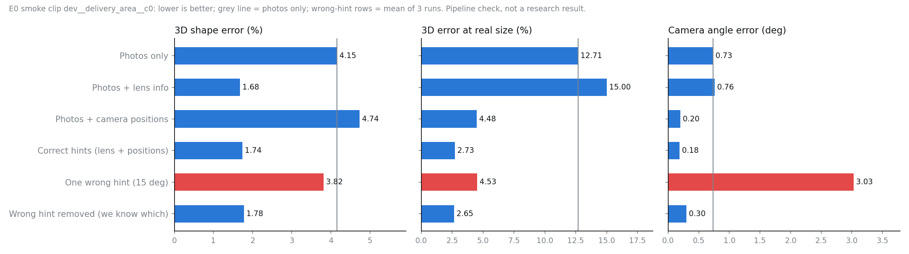
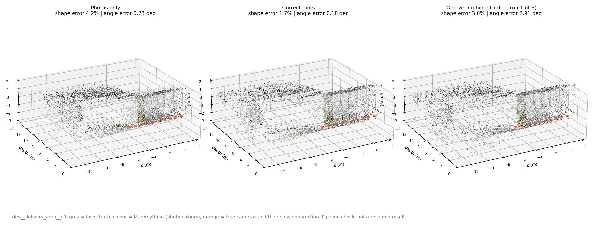
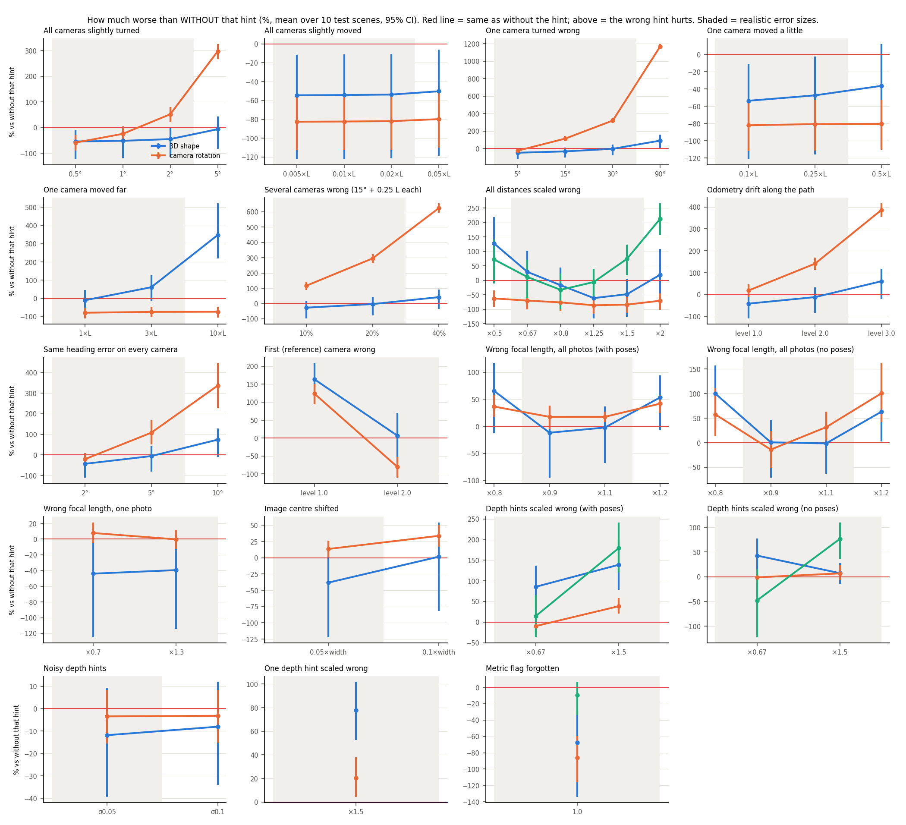
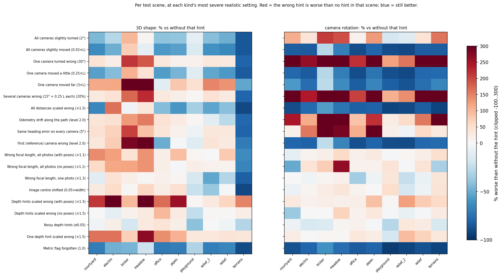
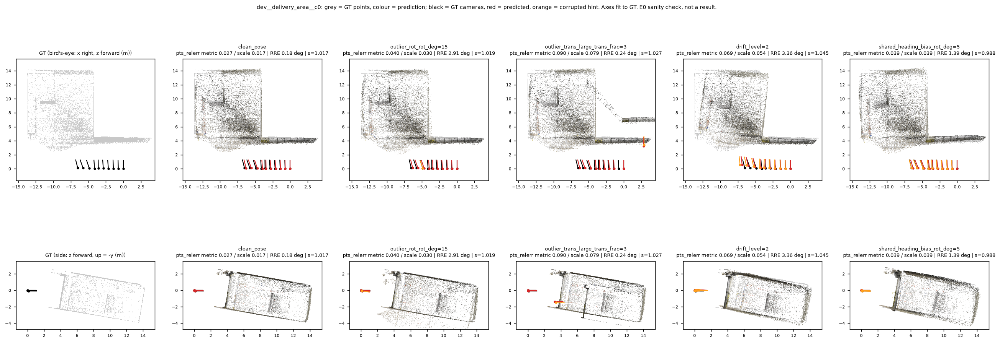
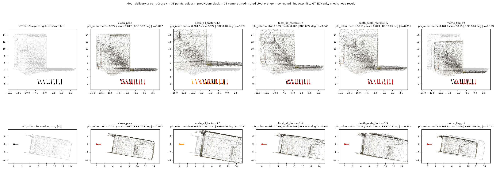

# E0 + E1 results: MapAnything with wrong hints

**Project:** do 3D foundation models trust bad hints? (`context.md`)
**Status:** 28 Oct 2026. E0 PASS; E1 done, **decision: Strong GO**.
**Code:** E1 eval grid frozen at `71582c1` (tag `e1-prereg`); results committed at `de76c01`.

Every number in this document is copied from a results file, and each section links its source. E0 smoke numbers come from one practice scene and check the pipeline; they are not research results. E1 numbers come from 10 held-out test scenes, run once from the frozen commit.

---

## Summary

1. **Plain MapAnything works correctly in our pipeline (E0).**
   - Correct hints make it much better, as the paper says: on the smoke scene, 3D shape error −58% and camera-rotation error −75% vs photos only.
   - Runs are bit-identical when repeated.
   - The ground truth checks out on all 13 scenes (worst 0.21% disagreement).
2. **E0 found and fixed 2 bugs in the harness.**
   - ETH3D's depth maps belong to the distorted photos; the delivered code crashed on the first image.
   - The dev/eval split was computed over whichever subset was passed in, which mislabelled 3 test scenes. No model ran on them before the fix.
3. **Wrong hints do make MapAnything worse than no hints (E1, H1 confirmed).** 13 of 19 kinds of wrong hint hurt at realistic error sizes.
4. **Wrong camera *directions* are the main danger.** One camera turned 15° made camera-rotation error +114% vs photos only, in 10/10 scenes; drift +141%; a shared 5° heading error +108%.
5. **Wrong scale is copied.** Distances ×1.5 made the scene ×1.38 too big. Wrong depth scale also hurts the 3D shape.
6. **Wrong camera *positions* are mostly harmless.** Only a 10-scene-length jump hurts.
7. **The model copies a bad pose almost completely** (median absorption 0.96), even though its own confidence flags the bad view (AUROC 0.91).
8. **The simple filter fixes big single outliers but fails on correlated errors** (drift, shared heading, scale) and on small ones (5°).

---

## 1. Setup (shared by E0 and E1)

| Item | Value | Source |
|---|---|---|
| Model | MapAnything, repo commit `3d10cf7a`, checkpoint `facebook/map-anything` (CC BY-NC 4.0), HF snapshot `a1d87e90`, 1.228 B parameters | [provenance.txt](e0_logs/provenance.txt) |
| Hardware / software | 1× A100-SXM4-80GB, driver 580, torch 2.14.1+cu130, Python 3.12 | [env_dump.txt](env_dump.txt) |
| Data | ETH3D high-res multi-view training set, 13 scenes, one clip of 10 consecutive photos each at 518×336. relief / relief_2 turned upright (336×518). Fixed split: dev = delivery_area, facade, terrace; eval = the other 10 | [gt_check.csv](e0_results/gt_check.csv) |
| Speed / memory | 0.26 s per 10-photo inference after warm-up, 8.26 GB peak | [8_det_b.txt](e0_logs/8_det_b.txt) |
| Determinism | Repeat runs bit-identical (max difference 0), so the noise floor for "no change" is 0 | [8_det_b.txt](e0_logs/8_det_b.txt) |
| Interface | Every call and input/output key checked against the MapAnything source with file:line evidence | [e0_interface.md](e0_interface.md) |

---

## 2. E0: does plain MapAnything run correctly in our pipeline?

**Goal:** trust the measuring setup before any experiment. E0 produces no research findings.

### 2.1 Checklist

| Check | Result | Evidence |
|---|---|---|
| Environment on the GPU, tests pass | PASS (31 tests at E0 close) | [env_dump.txt](env_dump.txt) |
| Interface verified against the source (10 questions) | PASS; `model_io.py` needed no functional change | [e0_interface.md](e0_interface.md) |
| Ground truth self-consistent on all 13 scenes | PASS; worst 0.21% | [gt_check.csv](e0_results/gt_check.csv) |
| Official README example | PASS; all outputs finite, 6.44 GB peak | [e0_official_example.txt](e0_official_example.txt) |
| Smoke runs: no failures, no resizing, `zero_noise` ≡ `clean_pose`, controls work | PASS; max difference 0 | [7_smoke_check.txt](e0_logs/7_smoke_check.txt) |
| Correct hints clearly beat photos only | PASS; shape −58%, rotation −75% | [numbers.csv](e0_results/numbers.csv) |
| Visual check of the 3D reconstruction | PASS; nothing mirrored, flipped or mis-scaled | [overview.png](e0_results/overview.png) |
| Runtime, memory, noise floor recorded | PASS; 0.26 s, 8.26 GB, 0 | [8_det_b.txt](e0_logs/8_det_b.txt) |

### 2.2 The vanilla run, in numbers (smoke scene `dev__delivery_area__c0`)

Lower is better. "Shape" = 3D point error after removing one overall size factor; "real size" = 3D point error at the model's own metric scale.

| Run | 3D shape error | 3D error at real size | Camera rotation error | Runs averaged |
|---|---|---|---|---|
| Photos only | 4.15% | 12.71% | 0.73° | 1 |
| Photos + lens info | 1.68% | 15.00% | 0.76° | 1 |
| Photos + camera positions | 4.74% | 4.48% | 0.20° | 1 |
| **Correct hints (lens + positions)** | **1.74%** | **2.73%** | **0.18°** | 1 |
| Correct hints via the damage code at size 0 | 1.74% | 2.73% | 0.18° | 1 |
| One wrong hint (one camera turned 15°) | 3.82% | 4.53% | 3.03° | 3 |
| Wrong hint removed (oracle, and the simple filter) | 1.78% | 2.65% | 0.30° | 3 |

Source: [numbers.csv](e0_results/numbers.csv), from `results/smoke*/per_run.csv`.




*Grey = laser-scanned truth; colour = MapAnything; orange = true cameras. More views: [overview.png](e0_results/overview.png). Interactive 3D: [e0_results.html](e0_results/e0_results.html).*

**Why a vanilla run still has error.** "Vanilla" means unchanged, not perfect. The error is the gap between MapAnything's answer and the laser scan. It comes from four sources:
- the model is an estimate;
- photos alone cannot reveal real-world size (here it guessed about 10% too small);
- hints are inputs, not rules;
- small images and plain, shiny walls are hard to match between photos.

The answer key itself disagrees with itself by at most 0.21%.

### 2.3 Ground-truth check, all 13 scenes

Laser depth from photo 1 is moved into the other photos with the true cameras and compared with their own laser depth. Pass rule: < 3%.

| Scene | Split | Worst disagreement | | Scene | Split | Worst disagreement |
|---|---|---|---|---|---|---|
| delivery_area | dev | 0.02% | | office | eval | 0.12% |
| facade | dev | 0.05% | | pipes | eval | 0.12% |
| terrace | dev | 0.21% | | playground | eval | 0.09% |
| courtyard | eval | 0.05% | | relief_2 | eval | 0.10% |
| electro | eval | 0.20% | | relief | eval | 0.09% |
| kicker | eval | 0.15% | | terrains | eval | 0.02% |
| meadow | eval | 0.18% | | | | |

All PASS, with flat error from image centre to corner. Source: [gt_check.csv](e0_results/gt_check.csv). ETH3D depth is sparse: 6–35% of pixels per clip carry a laser value.

### 2.4 Bugs found and fixed in E0

1. **Depth on the wrong image grid.** ETH3D's depth maps (6048×4032) belong to the distorted photos, but the harness paired them with the undistorted ones (about 6200×4130), so it crashed on the first image. The depth is now re-mapped through the lens model, as MapAnything's own ETH3D code does. The lens model matches `pycolmap` to 1e-12 px.
2. **Wrong dev/eval labels.** The split was computed over whichever scenes were passed in, so a subset run labelled 3 test scenes as practice scenes. The split is now always over the full 13-scene list, with a test covering it. No model ran on the mislabelled clips.

---

## 3. E1: do wrong hints make MapAnything worse than no hints?

### 3.1 Design

- **19 kinds of wrong hint in 5 groups, 65 settings, 235 inferences per scene** ([E1.md §3](../../experiments/E1.md), [e1_full.json](../configs/e1_full.json)):
  - **P**, independent pose errors (each camera wrong on its own);
  - **C**, correlated pose errors (scale, drift, shared heading, wrong first camera);
  - **K**, lens errors;
  - **D**, depth-hint errors;
  - **M**, a forgotten metric flag.
- **Paired comparisons.** Each wrong-hint run is compared with the same scene **without** that hint (the "floor") and **with** the correct hint (the "ceiling").
- **Preregistered.** The grid and the decision rules were frozen at `71582c1` after a debugging run on the 3 practice scenes. The 10 test scenes were then run **once**: 2,350 of 2,350 runs, 0 failures, about 1 h 55 min on the shared A100 ([e1_eval_console.txt](e1_logs/e1_eval_console.txt)).
- **Amendments.** 16 interpretations of the plan were written down before the freeze ([E1.md, Amendments](../../experiments/E1.md)). Two were explicitly approved by the user:
  - the metric-flag sanity check;
  - a 5% minimum effect for "harm".
- **Test scenes.** Scene sizes L (median camera distance from the centroid) range from 0.25 m (office) to 6.76 m (meadow) ([scene_lengths.csv](e1_results/scene_lengths.csv)).

### 3.2 Decision: Strong GO

| Signal | Question | Answer | Evidence |
|---|---|---|---|
| S1 Harm | Do wrong hints make it worse than no hints? | **YES** | 13 of 19 kinds, at realistic sizes; e.g. one camera turned 15°: rotation +114%, 10/10 scenes |
| S2 Spread | Does one bad hint damage the good views? | **YES** (marginal) | 20% of cameras wrong: good views' rotation error +20.4% (bar: 20%) |
| S3 Blind trust | Does the model copy bad hints? | **YES** | median absorption 0.96 for single bad cameras |
| S4 Silent | Does the model fail to notice? | **NO** | its confidence ranks the bad view lower (AUROC 0.91) |
| S5 Simple fix fails | Is the easy filter not enough? | **YES** | drift level 2: 9% recovered; shared 5° heading: 1%; 5° outlier: 4%; lens / depth: no filter applies |
| S6 Agrees-but-wrong | Do correlated / lens / depth errors hurt? | **YES** | drift, shared heading, scale, wrong first camera, focal length and depth scale all meet S1 |
| S7 Realistic | Does it happen at realistic error sizes? | **YES** | all of the above are at realistic settings |

Rule (frozen): Strong GO = S1 + S5 + S7 + (S2 or S6). Source: [signals.json](e1_results/signals.json).

### 3.3 Headline: how much worse than without that hint



*One panel per kind. Red line = same as without that hint; above it, the wrong hint hurts. Shaded = realistic sizes. Mean over the 10 test scenes, 95% CI. Source: [dose_response.csv](e1_results/dose_response.csv).*



*Per scene, at each kind's most severe realistic setting: the effects are consistent across scenes, not one unlucky one.*

### 3.4 Each kind of wrong hint, at its worst realistic setting

"vs without hint" compares with the family's floor: photos only for pose hints, no lens info for lens hints, no depth hints for depth hints. "vs dropping poses" compares with photos + lens and all poses removed (+ = dropping the poses would have been better).

| Group | Wrong hint (real-world cause) | Setting | Harm at realistic size? | 3D shape vs without hint | Rotation vs without hint | Rotation Δ | Scenes worse | vs dropping poses |
|---|---|---|---|---|---|---|---|---|
| P | All cameras slightly turned (jittery tracking) | 2° | **YES** | -45% | +52% | +0.73° | 80% | +135% |
| P | All cameras slightly moved (jittery tracking) | 0.02×L | no | -54% | -82% | -1.16° | 10% | +15% |
| P | One camera turned wrong (bad compass reading / flipped photo) | 30° | **YES** | -3% | +320% | +4.53° | 100% | +550% |
| P | One camera moved a little (small GPS glitch) | 0.25×L | no | -47% | -81% | -1.14° | 20% | +31% |
| P | One camera moved far (GPS jump) | 3×L | only extreme | +62% | -74% | -1.04° | 80% | +302% |
| P | Several cameras wrong (15° + 0.25 L each) (bad stretch of sensor data) | 20% | **YES** | -4% | +295% | +4.17° | 100% | +511% |
| C | All distances scaled wrong (wrong units / scale drift) | ×0.67 | **YES** | +29% | -70% | -0.99° | 70% | +222% |
| C | Odometry drift along the path (visual-inertial drift) | level 2.0 | **YES** | -11% | +141% | +2.00° | 100% | +273% |
| C | Same heading error on every camera (compass / gravity misalignment) | 5° | **YES** | -6% | +108% | +1.53° | 90% | +221% |
| C | First (reference) camera wrong (bad first frame) | level 1.0 | **YES** | +164% | +123% | +1.75° | 100% | +555% |
| K | Wrong focal length, all photos (with poses) (wrong EXIF / calibration) | ×1.1 | **YES** | -2% | +18% | +0.05° | 90% | -66% |
| K | Wrong focal length, all photos (no poses) (wrong EXIF / calibration) | ×1.1 | **YES** | -1% | +32% | +0.45° | 80% | – |
| K | Wrong focal length, one photo (one photo with wrong metadata) | ×0.7 | no | -44% | +8% | +0.02° | 70% | -69% |
| K | Image centre shifted (crop / resize metadata bug) | 0.05×width | **YES** | -38% | +14% | +0.04° | 70% | -68% |
| D | Depth hints scaled wrong (with poses) (depth sensor / mono-depth scale) | ×1.5 | **YES** | +139% | +39% | +0.09° | 100% | +170% |
| D | Depth hints scaled wrong (no poses) (depth sensor / mono-depth scale) | ×0.67 | **YES** | +43% | -1% | -0.01° | 90% | – |
| D | Noisy depth hints (noisy depth sensor) | σ0.05 | no | -12% | -3% | -0.01° | 50% | -74% |
| D | One depth hint scaled wrong (one bad depth map) | ×1.5 | **YES** | +78% | +20% | +0.05° | 100% | +101% |
| M | Metric flag forgotten (user forgets the flag) | 1.0 | no | -67% | -86% | -1.21° | 0% | -19% |

Notes:
- *Harm* means some primary metric meets S1 at some realistic setting. The number columns show the setting with the largest shape-or-rotation change.
- For the scale families the harm is in **real size**: distances ×1.5 gave 3D error at real size +75% vs photos only (8/10 scenes); depth hints ×1.5 without poses, +77%.
- "3×L" did not count as harm: 8/10 scenes were worse, but the 95% CI touches zero.
- Source: [family_summary.csv](e1_results/family_summary.csv), [dose_response.csv](e1_results/dose_response.csv).

### 3.5 Does one bad hint hurt the good views? (S2)

Mostly a little. The only case over the preregistered 20% bar is 20% of cameras wrong, where the good views' rotation error rose by 20.4%.

| Damage | Good-view 3D error | Good-view rotation error |
|---|---|---|
| One camera turned 5° / 15° / 30° | +3.0% / +3.9% / +2.7% | +2.7% / +7.8% / +5.7% |
| One camera moved 0.1 L / 0.25 L | +0.7% / +3.6% | +0.0% / +2.3% |
| One camera moved 1 L / 3 L | +8.6% / +13.0% | +3.8% / +7.1% |
| 10% / 20% of cameras wrong | +5.1% / +4.9% | +3.9% / **+20.4%** (CI of Δ [0.021°, 0.074°]) |

Source: [contamination.csv](e1_results/contamination.csv).

### 3.6 Does the model copy bad hints, and does it notice? (S3, S4)

**It copies them.** Median absorption, where 1 means the model fully copies the bad hint: single bad camera turned 0.86–0.99; moved 0.88–1.00; several bad cameras 0.94–0.95; all focal lengths wrong 0.85–0.90. It copies less of a single wrong focal length (0.55–0.67) and of wrong depth scale given with poses (0.47–0.50). Source: [absorption.csv](e1_results/absorption.csv).

**Yet its confidence notices.** AUROC is the chance that a good view scores "cleaner" than the bad view of the same run (0.5 = no signal):

| Damage | Model confidence | Disagreement with photos-only (rotation) | Disagreement (direction) |
|---|---|---|---|
| One camera turned | 0.94 | 0.99 | 0.52 |
| One camera moved a little | 0.80 | 0.42 | 0.79 |
| One camera moved far | 0.97 | 0.49 | 0.98 |
| Several cameras wrong | 0.90 | 1.00 | 0.81 |
| Wrong focal length, one photo | 0.94 | 0.51 | 0.52 |
| **Pooled** | **0.91** | 0.71 | 0.73 |

Source: [confidence_auroc.csv](e1_results/confidence_auroc.csv).

### 3.7 Wrong scale (C1, D1, M1)

The model largely adopts a wrong metric scale: for distances it takes on 62–79% of the injected factor (in log terms, depending on the factor).

| Damage | Injected | Predicted scene size ÷ correct-hint size (95% CI) |
|---|---|---|
| All distances | ×0.5 / ×0.67 / ×0.8 | ×0.65 [0.54, 0.78] / ×0.76 [0.69, 0.84] / ×0.85 [0.82, 0.89] |
| All distances | ×1.25 / ×1.5 / ×2 | ×1.18 [1.15, 1.22] / ×1.38 [1.32, 1.43] / ×1.68 [1.57, 1.80] |
| Depth hints, with poses | ×0.67 / ×1.5 | ×0.92 [0.89, 0.96] / ×1.11 [1.08, 1.14] |
| Depth hints, no poses | ×0.67 / ×1.5 | ×0.88 [0.85, 0.92] / ×1.33 [1.28, 1.37] |
| Metric flag forgotten | – | ×1.16 [1.06, 1.28] |

Source: [scale.csv](e1_results/scale.csv), figure [fig_scale.png](e1_results/fig_scale.png).

### 3.8 Simple filter vs oracle (S5), camera rotation error

The oracle removes exactly the bad hints for single and fraction outliers, and drops all poses for correlated errors. The filter drops any pose that disagrees with the photos-only prediction by more than 10° in rotation or 15° in direction.

| Damage | Damaged | Oracle | Simple filter | Filter recovery |
|---|---|---|---|---|
| One camera turned 5° | 1.08° | 0.37° | 1.05° | 4% |
| One camera turned 15° / 30° | 3.03° / 5.94° | 0.36° / 0.38° | 0.42° / 0.43° | 98% / 99% |
| 10% / 20% of cameras wrong | 3.05° / 5.59° | 0.35° / 0.46° | 0.40° / 0.51° | 98% / 99% |
| Drift level 1 / 2 | 1.69° / 3.41° | 0.91° | 1.65° / 3.19° | 4% / 9% |
| Same heading error 2° / 5° | 1.12° / 2.94° | 0.91° | 1.14° / 2.92° | -8% / 1% |

- **The filter also raises false alarms.** It drops about 0.7 poses per run even when every direction is right, e.g. 0.70 when all distances are only rescaled.
- **Lens and depth damage cannot be filtered this way at all.**
- Source: [fix.csv](e1_results/fix.csv).

### 3.9 What it looks like (practice scene, qualitative)




*Practice scene delivery_area. Grey = laser truth, colour = MapAnything, black = true cameras, red = predicted cameras, orange = the wrong hint.*

### 3.10 Diagnostics and caveats

- **Eval-run checks** ([e1_eval_console.txt](e1_logs/e1_eval_console.txt)):
  - **pass:** all 2,350 runs present; the harness invariance (`scale_all_nonmetric_x1.5` ≡ `metric_flag_off`) exact; `zero_noise` and `scale_all_x1.0` identical to `clean_pose`; severity sweeps monotone; oracle quality as expected; per-view logs complete;
  - **one tolerance miss:** moving every camera together (`gauge_rigid`) should change nothing. In electro, rotation error changed by 0.026° (9.4%, and *better*); 6 of 10 scenes were bit-identical. This is floating-point rounding, and it is not part of the decision.
- **S2 is marginal:** +20.4% against a 20% bar.
- **"Benefit lost"** (the plan's ratio) divides by how much the correct hint helps, so it swings wildly for lens and depth hints. This document therefore leads with "% vs without the hint". The decision rules use the ratio together with a 5% minimum effect. The plan's own figures are kept: [fig_dose_response.png](e1_results/fig_dose_response.png), [fig_scene_heatmap.png](e1_results/fig_scene_heatmap.png).
- **"Realistic sizes"** follow the preregistered rule (drop the most severe setting of each sweep). For the paper they still need literature backing (phone GPS error, VIO drift rates, EXIF focal error, depth-sensor scale error).
- **Scope:** one clip of 10 photos per scene, 10 test scenes, one model. The OmniVGGT replication is E4.

---

## 4. What this means for the project

- **The problem is real (H1 confirmed).** MapAnything trusts wrong hints, especially camera *rotations*, and ends up worse than with photos alone at realistic error sizes.
- **For E2 (mechanism).** H2 blames the mean-based *pose scale*. But E1's harm comes mostly from rotation errors, which that statistic never sees; translation errors are mostly absorbed safely. That points away from the scale statistic as the main cause. E2 tests this directly by swapping mean for median: a small patch, under an hour of GPU time.
- **For E3 (detection).**
  - The model's own confidence already flags single bad views (AUROC 0.91), so single-outlier detection alone is not novel.
  - The simple filter fails on **correlated** errors (drift, shared heading, scale, depth scale), and raises false alarms.
  - Disagreement with photos-only is not easy everywhere (AUROC 0.42–1.00 by kind). Under the plan's own rule, E3 should therefore target the correlated cases.

---

## 5. Files and reproduction

| What | Where |
|---|---|
| E0 results page (offline, 3D viewer) and PDF | [e0_results/e0_results.html](e0_results/e0_results.html), [e0_results.pdf](e0_results/e0_results.pdf) |
| E1 results page (offline) and PDF | [e1_results/e1_results.html](e1_results/e1_results.html), [e1_results.pdf](e1_results/e1_results.pdf) |
| E1 technical report | [e1_results.md](e1_results.md) |
| Environment and reproduction (Deliverable A) | [exp1_environment_and_reproduction.md](exp1_environment_and_reproduction.md) |
| Interface verification | [e0_interface.md](e0_interface.md) |
| Plans, frozen rules, amendments | [experiments/E0.md](../../experiments/E0.md), [experiments/E1.md](../../experiments/E1.md) |
| Raw runs (git-ignored) | `results/smoke*`, `results/e1_eval/` |

```bash
# E1 (from the frozen commit)
git checkout e1-prereg
python -m exp1.run_exp1 --config configs/e1_full.json --clips 'data/clips/eval__*.npz' --out results/e1_eval
python -m exp1.e1_analysis --run results/e1_eval --checks
python scripts/e1_make_report.py --takeaways reports/e1_results_takeaways.html
# E0 results package
python scripts/e0_make_results.py --pdf_browser <chrome>
```
