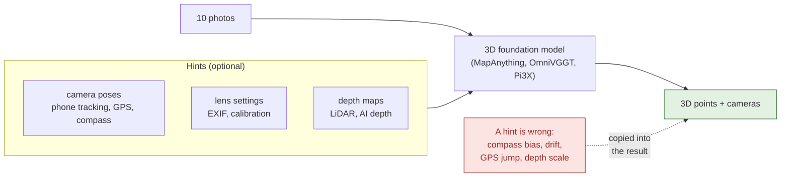
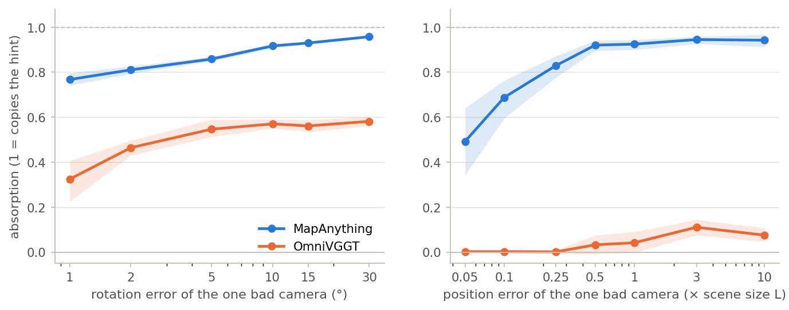
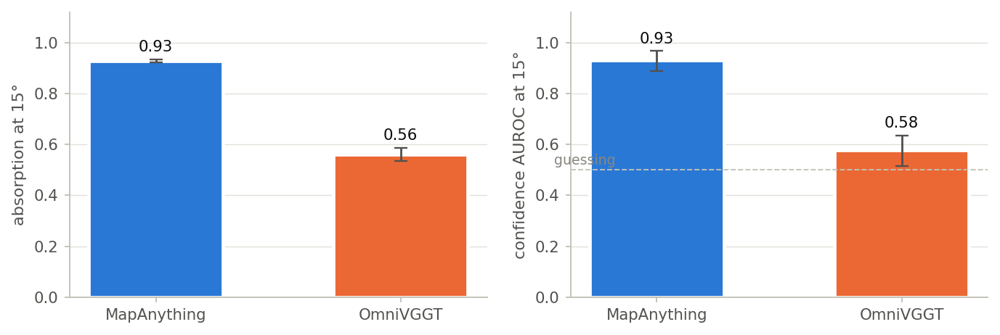
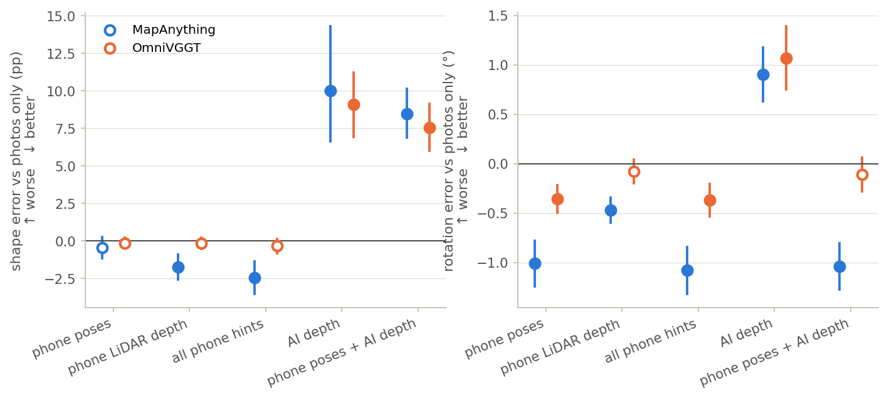
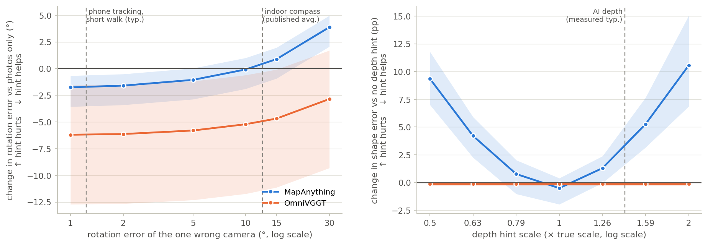
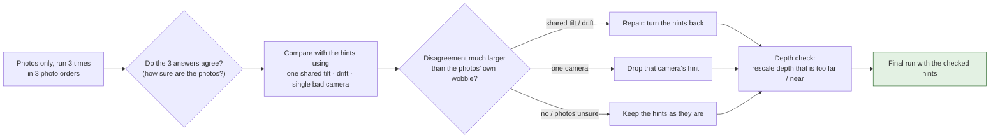
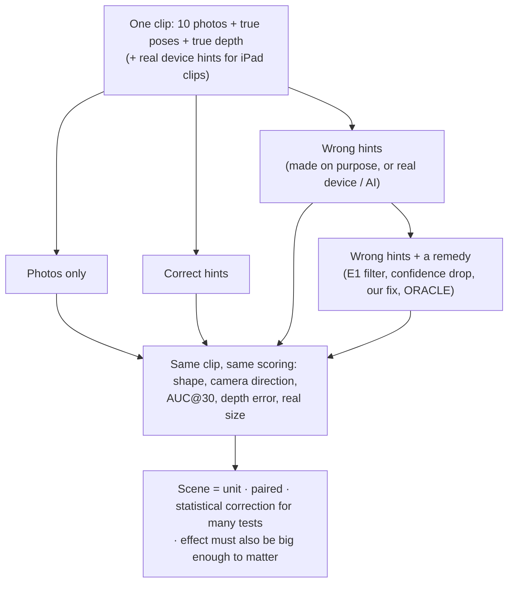

# They Know, but They Obey
### When should a 3D foundation model trust its hints?

*Working title. Target: a CVPR 2027 workshop. Status, 4 Nov 2026: E0–E2 done, extended E2 (E2X) prepared, fix (E3) prototyped. Nothing below is final; every number links to the file it came from.*

> **TL;DR.**
> - Feed-forward 3D models such as MapAnything accept *hints*: camera poses, lens settings, depth maps.
> - We show they **obey wrong hints**, copying most of the error into the 3D result, **even when their own confidence shows they noticed**. A hint then helps only while its error stays below what the photos alone could get right.
> - Some real hint sources are on the wrong side of that line: AI-estimated depth already is, and indoor compass headings probably are.
> - We are building a training-free check that lets the photos overrule hints they clearly contradict, without throwing away the good ones.

Other title candidates: *Fused as if Perfect: 3D Foundation Models Don't Weigh Their Hints* · *Blind Trust: How Wrong Priors Break Feed-Forward 3D Reconstruction* · *Garbage In, Geometry Out*.

---

## The problem in one picture



Correct hints make these models much better: MapAnything's two-photo benchmark error drops from 0.08 to 0.02 with all hints ([MapAnything, arXiv 2509.13414](https://arxiv.org/abs/2509.13414), Table 2). Real hints come from phones, GPS, compasses, depth sensors or AI depth estimators, and are sometimes wrong. We ask three questions:

1. **Do wrong hints make the result worse than using no hints at all?**
2. **Why does that happen?**
3. **Can bad hints be caught and fixed automatically, using only the photos, with no retraining?**

---

## Findings so far

### 1. Wrong camera *directions* hurt; wrong *positions* mostly don't (E1)

On 10 ETH3D scenes, 2,350 runs, compared with photos only:

| Hint error | Change in camera-direction error |
|---|---|
| one camera turned 15° | **+114%** (all 10 scenes worse) |
| drift (level 2) | **+142%** |
| all cameras share a 5° compass error | **+108%** |
| one camera's position off by up to 3 scene sizes | mostly absorbed (only a 10× jump hurts) |

Source: [`reports/e1_results.md`](MapAnything_Exp1/reports/e1_results.md), [`results/e1_eval/agg/signals.json`](MapAnything_Exp1/results/e1_eval/agg/signals.json).

### 2. MapAnything copies wrong hints and never overrules them (E2)



- **MapAnything** copies 77% of a 1° error and 96% of a 30° error. Nothing in between makes it stop and use the photos instead.
- **OmniVGGT** copies about half of a direction error.

Source: [E2 report](MapAnything_Exp1/reports/e2_results/e2_results.pdf), [`results/e2c_eval/agg/`](MapAnything_Exp1/results/e2c_eval/agg/).

### 3. It *knows*, but it *obeys*



With one camera turned 15°:
- MapAnything copies the error (absorption 0.93);
- yet its own confidence ranks the bad camera below a good one in 93 of 100 random pairs (AUROC 0.93).

The information needed to reject the hint exists inside the model; nothing uses it. Its confidence reacts much less when **all cameras are wrong together** (shared compass error, drift), which is the kind of error real devices make.

Replacing the model's averaging step (mean → median pose scale) changes nothing, so the damage happens **inside the network**. Source: [E2 report §§4–6](MapAnything_Exp1/reports/e2_results/e2_results.pdf).

### 4. Real device hints help; AI depth hurts both models (E2-E)



On 15 real rooms (SceneFun3D / ARKitScenes, iPad):
- **The iPad's own camera tracking helps:** MapAnything direction error −1.01°, size error −31 points.
- **AI depth (Depth Anything V2) hurts both models:** shape +10.0 / +9.1 points and direction +0.90° / +1.07° (MapAnything / OmniVGGT). It is typically ×1.42 too far.

Source: [`results/e2def_agg/e_tests.csv`](MapAnything_Exp1/results/e2def_agg/e_tests.csv).

### 5. The break-even point: a hint helps only until its error passes the photos' own error



| MapAnything | Hint helps | Hint hurts |
|---|---|---|
| one wrong camera | up to about 5° (−1.06°) | clearly at 30° (+3.88°) |
| depth scale | ×0.79 to ×1.26 | ×0.63 and below, ×1.59 and above |

- The break-even point for one wrong camera is near 10°.
- **Where real sources sit:** phone tracking (about 1.2° worst camera on short walks) is safely below break-even. AI depth (×1.42) and the average indoor compass error (12.45°, published) are above it.
- **OmniVGGT** is never worse than its own photos-only mode, because that mode is weak. So the break-even point depends on how good the photos are.

This is a descriptive, after-the-fact view of finished E2 runs: [`results/e2x_angle_preview/`](MapAnything_Exp1/results/e2x_angle_preview/). Figure code: [`scripts/e2x/make_readme_figures.py`](MapAnything_Exp1/scripts/e2x/make_readme_figures.py).

### 6. Existing remedies either miss shared errors or throw away good data (E2-F)

- **E1's simple filter** (drop a camera hint that disagrees with the photos by more than 10°):
  - fixes a single 90° outlier (1.3% of the damage left);
  - cannot see errors that all cameras share;
  - on real iPad data drops 9.5% of the cameras and makes the result worse (+0.19°).
- **"Drop all poses"** removes 80–90% of the damage from shared errors, but also all the benefit of good poses.

Source: [`results/e2def_agg/f_remaining_gap.csv`](MapAnything_Exp1/results/e2def_agg/f_remaining_gap.csv), [`f_real_hints.csv`](MapAnything_Exp1/results/e2def_agg/f_real_hints.csv).

### 7. Phone tracking drifts over a whole room, and even "ground truth" can be wrong

Across 150 SceneFun3D recordings, the worst camera's error from the iPad's own tracking grows with how spread out the photos are:

| Photos spread over | Typical worst-camera error | Clips over 5° |
|---|---|---|
| a short walk | 1.23° | 4.6% |
| the whole recording | 2.88° | 20.7% |

The dataset's own "ground truth" has frames that jump: 493 of 73,512 by more than 5°, 80 by more than 30°. The iPad's tracking never jumps more than 30°. Every new clip was therefore checked against its own photos before use (21 of 114 excluded).

Source: [`results/e2x_survey/`](MapAnything_Exp1/results/e2x_survey/), [`results/e2x_clip_check/`](MapAnything_Exp1/results/e2x_clip_check/).

---

## What we are building: let the photos overrule bad hints (E3)



- **Why this, and not a filter?** Per-camera filters can't see errors that all cameras share, and they throw away good data. This check **models** the typical ways real hints go wrong (a shared tilt, drift, one bad camera, a wrong depth scale), **repairs** what it can explain, and **leaves hints alone when the photos are not sure**.
- **Training-free and model-agnostic.** It runs on MapAnything, OmniVGGT and Pi3X through the same runner. The extra cost is a few extra runs per clip (one run takes 0.26 s, E0).
- **Status:** prototyped and tested with fake models ([`exp1/e3.py`](MapAnything_Exp1/exp1/e3.py), [`exp1/witness.py`](MapAnything_Exp1/exp1/witness.py), [`tests/test_e3.py`](MapAnything_Exp1/tests/test_e3.py)). Its cut-offs are set on separate calibration rooms with a rule fixed in advance ([`exp1/e3_calibrate.py`](MapAnything_Exp1/exp1/e3_calibrate.py)).
- **How it will be judged:** two numbers per remedy, on the same clips:
  - how much of the **good-hint benefit it keeps**;
  - how much of the **bad-hint damage it removes**.

  Existing remedies sit at the corners; the fix has to reach the top-right.

---

## Roadmap


| Step | Plan | Results |
|---|---|---|
| E0 | [`experiments/E0.md`](experiments/E0.md) | [`reports/exp1_environment_and_reproduction.md`](MapAnything_Exp1/reports/exp1_environment_and_reproduction.md) |
| E1 | [`experiments/E1.md`](experiments/E1.md) | [E1 report](MapAnything_Exp1/reports/e1_results/e1_results.pdf) |
| E2 | [`experiments/E2.md`](experiments/E2.md) | [E2 report](MapAnything_Exp1/reports/e2_results/e2_results.pdf) |
| E2X | [`experiments/E2X.md`](experiments/E2X.md), runbook [`experiments/E2X_instructions.md`](experiments/E2X_instructions.md) | plain-language overview: [`reports/e2x_plan/e2x_plan.pdf`](MapAnything_Exp1/reports/e2x_plan/e2x_plan.pdf) |
| E3 | preregistered after E2X calibration | — |

**Continue/stop rules for E2X are fixed before it runs** ([`E2X.md` §5](experiments/E2X.md)):
- **Method paper** if real whole-room hints hurt, or the fix beats the existing remedies on the safety-vs-benefit plot, **and** the fix can be calibrated without touching correct hints.
- **Analysis paper** if the fix cannot be calibrated safely.

---

## How an experiment works



**Rules we keep** ([`context.md` §6](context.md)):
- every condition grid and decision rule is **preregistered** (git tags `e1-prereg`, `e2-prereg-C`, `e2-prereg-DEF`; next `e2x-prereg`);
- eval clips are run once from the frozen tag;
- every reported number links to a results file.

---

## Setup

| | What | Notes |
|---|---|---|
| **Models** | [MapAnything](https://github.com/facebookresearch/map-anything) (main) | weights CC BY-NC 4.0; commit `3d10cf7a`, HF snapshot `a1d87e90` |
| | [OmniVGGT](https://github.com/Livioni/OmniVGGT-official) (second) | code MIT; trained from VGGT (CC BY-NC); commit `c8cbfc6` |
| | [π3-X / Pi3X](https://github.com/yyfz/Pi3) (third, E2X) | code BSD-3, weights CC BY-NC 4.0; commit `9fa3ddb` |
| | [Depth Anything V2](https://github.com/DepthAnything/Depth-Anything-V2) metric-indoor Large | only to *produce* AI depth hints |
| **Data** | [ETH3D](https://www.eth3d.net) high-res multi-view (13 scenes) | CC BY-NC-SA 4.0; errors put in on purpose, exact ground truth |
| | [SceneFun3D](https://scenefun3d.github.io) test split (= ARKitScenes Validation) | CC BY 4.0 + ARKitScenes terms; real iPad poses, LiDAR, AI depth |
| **Compute** | one GPU; inference only | MapAnything: 0.26 s and 8.26 GB per 10-photo run (A100, bf16; E0) |

---

## Repository layout

```
context.md                     full project context and decision log (start here)
experiments/                   plans and preregistrations: E0, E1, E2, E2X (+ runbook), G (gate tests)
docs/figures/                  README figures
MapAnything_Exp1/
  exp1/                        library: clips, corruptions, model connectors, metrics, runner, analyses, E3
    model_io*.py               the only files that call MapAnything / OmniVGGT / Pi3X
    run_exp1.py                condition x clip x seed runner (resumable, sharded)
    e3.py, witness.py          the fix (E3) and its error model
  configs/                     condition grids (frozen ones are never edited)
  scripts/                     VM setup and queues, reports, analyses, checks
  tests/                       CPU tests with fake models (pytest)
  results/                     every run, tracked in git
  reports/                     E1 / E2 reports (HTML + PDF), E2X overview
```

## Running things

```bash
cd MapAnything_Exp1
python -m pytest -q tests --ignore=tests/test_gate.py      # CPU, fake models, about 12 min
```
- **GPU sessions:** follow [`experiments/E2X_instructions.md`](experiments/E2X_instructions.md) (bundle, launch, monitor, fetch, analyse).
- **Clips:** rebuilt from public data by `exp1/datasets.py` (ETH3D) and `exp1/arkit_clips.py` (SceneFun3D, range reads of only the needed frames).

---

## How this relates to existing work

| Work | What it does with hints | How we differ |
|---|---|---|
| [Pow3R](https://arxiv.org/abs/2503.17316) (CVPR 2025) | two views; refuses grossly wrong hints | many views, three models, measured real hints, a check that also repairs shared errors |
| [VPGGT](https://arxiv.org/abs/2610.05531) (Oct 2026) | retrains OmniVGGT with noisy poses | training-free; says *which* hint is bad; covers depth and shared errors |
| [WorldMirror](https://arxiv.org/abs/2510.10726) | reports graceful degradation under hint noise | break-even curves, real sources, a fix |
| [TCO](https://arxiv.org/abs/2604.03878) | uses hints as test-time constraints; never rejects them | rejects or repairs hints the photos contradict |
| [SpatialBench](https://arxiv.org/abs/2605.27367) | injects *correct* priors; MapAnything adheres strongly | *wrong* priors, at sizes taken from published sources and real devices |

## Honest limitations, so far

- The only real-world harm measured by us so far is AI depth. Harm from real camera-direction errors is what E2X tests next (whole-room iPad clips).
- Simple remedies already remove most of the damage from errors put in on purpose. The fix must win on *keeping good hints*, not only on removing damage.
- The break-even curves above are descriptive, computed after the fact on finished runs.

## Acknowledgements

- Built on MapAnything, OmniVGGT (from VGGT), Pi3/Pi3X and Depth Anything V2.
- Data: ETH3D, SceneFun3D and ARKitScenes.
- Experiment harness by Shubh; analysis and E2/E2X pipeline in this repo.
- All weights and data are used for non-commercial research under their licences.
